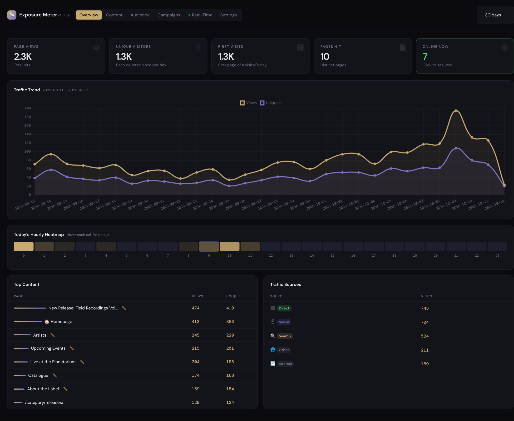
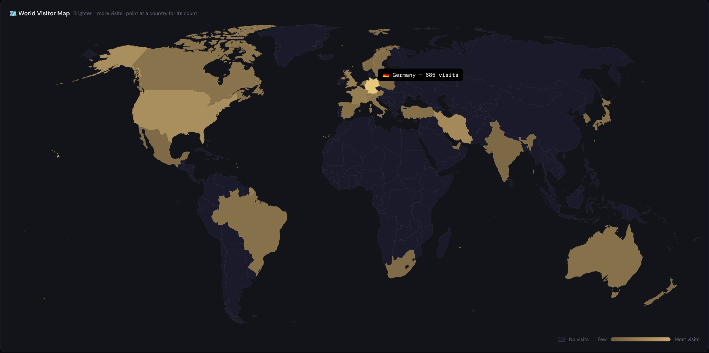
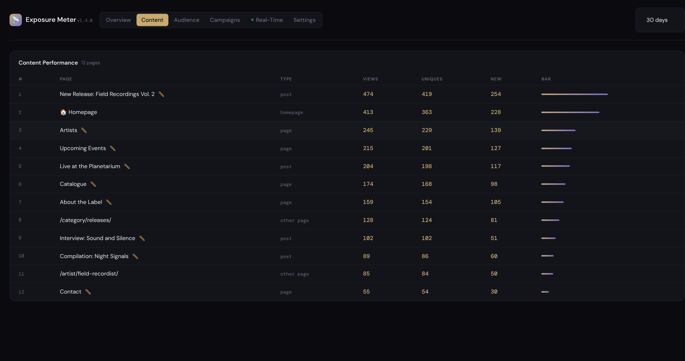
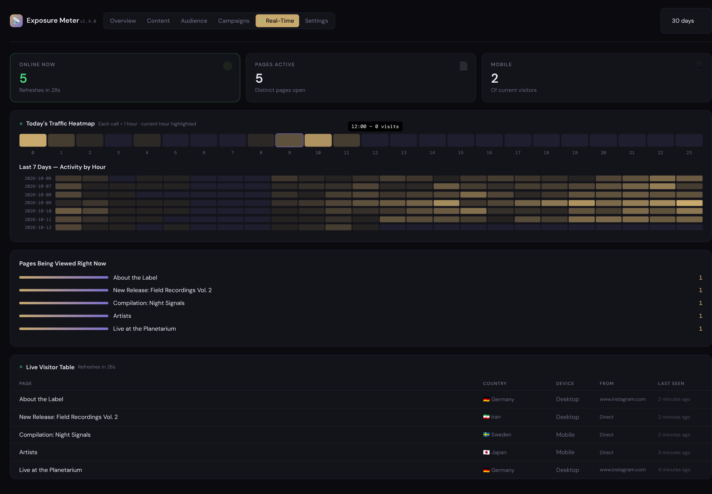

# Exposure Meter

Privacy-first visitor statistics for WordPress, made for musicians and record labels.
It stores no IP addresses, sets no cookies, loads nothing from other servers in the
dashboard, and draws a world map of where your listeners are.

Built for and in use on [anoise.org](https://anoise.org), the website of the Noise à Noise
label.

## What it shows

- **Overview**: page views, visitors, first visits, pages hit, who is online now, a 30-day
  trend, today's activity by hour, top content and where visitors came from (direct,
  search, social, other sites).
- **Content**: every post and page with views and visitors. Archives, the front page and
  other pages are listed by their address.
- **Audience**: a world map and table of countries, plus devices, browsers and operating
  systems.
- **Campaigns**: links tagged with `utm_campaign`, `utm_source` and `utm_medium`, so you can
  see which announcement, newsletter or post brought people in, and which sites link to
  you.
- **Real-time**: who is on the site right now and which pages they are reading.
- A statistics box on each post's editing screen, a 30-day sparkline in the post lists, a
  dashboard widget, and an optional daily or weekly email report.

| Content | Real-time |
| --- | --- |
|  |  |

The screenshots use invented demo data.

## Privacy

- **No IP addresses are stored.** A visitor's address is shortened the moment it arrives
  (the last part of an IPv4 address is set to 0; of an IPv6 address only the network part
  is kept), and only the shortened form is ever used.
- **Visitors are recognised for one day only.** A one-way code is made from the shortened
  address, the browser's name, the date and a secret of your site. It changes every day,
  so the same person is counted once per day and cannot be followed from one day to the
  next.
- **No cookies** are set, and nothing in the visitor's browser is read or stored.
- **Country lookup.** To know a visitor's country, the shortened address (for example
  `203.0.113.0`) is sent to [ip-api.com](https://ip-api.com) and the answer is cached
  for a day. Their free service is for non-commercial use and works over plain HTTP;
  please read their [terms](https://ip-api.com/docs/legal) before using this plugin on a
  commercial site. Looking countries up inside the plugin is planned (see below).
- **The dashboard loads nothing from other servers.** The chart library and the fonts
  come with the plugin.
- Chosen user roles (administrators and editors by default) and known bots are not
  counted.

This describes what the plugin does; it is not legal advice about your obligations.

## Requirements

- WordPress 6.0 or later
- PHP 8.0 or later
- MySQL or MariaDB (as WordPress itself)

## Installation

1. Download `exposure-meter.zip` from the [latest release](../../releases/latest).
2. In WordPress, go to **Plugins → Add New → Upload Plugin**, choose the file and activate it.
3. Open **Exposure Meter → Settings**:
   - If your site uses a page cache (LiteSpeed Cache, WP Rocket, W3 Total Cache, WP Super
     Cache…), turn on **Cache-Compatible Mode**. Cached pages are then counted by a small
     script in the page; without it, most visits to cached pages are missed. The settings
     page tells you when it finds one of these plugins.
   - Choose which user roles are not counted, how long detailed visits are kept, and
     whether you want an email report.

Statistics use your site's time zone (**Settings → General**).

## Planned improvements

- Look up countries inside the plugin, so no address leaves your server.
- Keep long-term history: daily totals are already saved but not yet shown, so visits
  older than the retention period disappear from the charts.
- A setting for sites behind a proxy or Cloudflare, so the visitor's address is read from
  the right place and cannot be faked.
- Translations, and the changes needed for the WordPress.org plugin directory.

## How it is built

- One PHP file, `exposure-meter.php`, plus `world-map.json` and `assets/`.
- The world map is drawn in advance by `tools/build-world-map.mjs` from Natural Earth data,
  so the browser only colours finished shapes.
- `tests/exposure-meter.php` checks the parts that need no WordPress: `php tests/exposure-meter.php`.
  It runs on every push (see `.github/workflows/test.yml`).
- Changes are listed in [CHANGELOG.md](CHANGELOG.md).

## Credits

- [Chart.js](https://www.chartjs.org) 4.4.0, MIT License (`assets/LICENSE-chartjs.txt`)
- [DM Sans](https://github.com/googlefonts/dm-fonts) and [DM Mono](https://github.com/googlefonts/dm-mono), SIL Open Font License 1.1 (`assets/fonts/LICENSE-fonts.txt`)
- Country shapes from [Natural Earth](https://www.naturalearthdata.com) (public domain) via
  [world-atlas](https://github.com/topojson/world-atlas), drawn with
  [d3-geo](https://github.com/d3/d3-geo) when the map is built

## Licence

GNU General Public License, version 2 or (at your option) any later version. See
[LICENSE](LICENSE).

Made by [Soheil Soheili](https://soheilsoheili.com).
